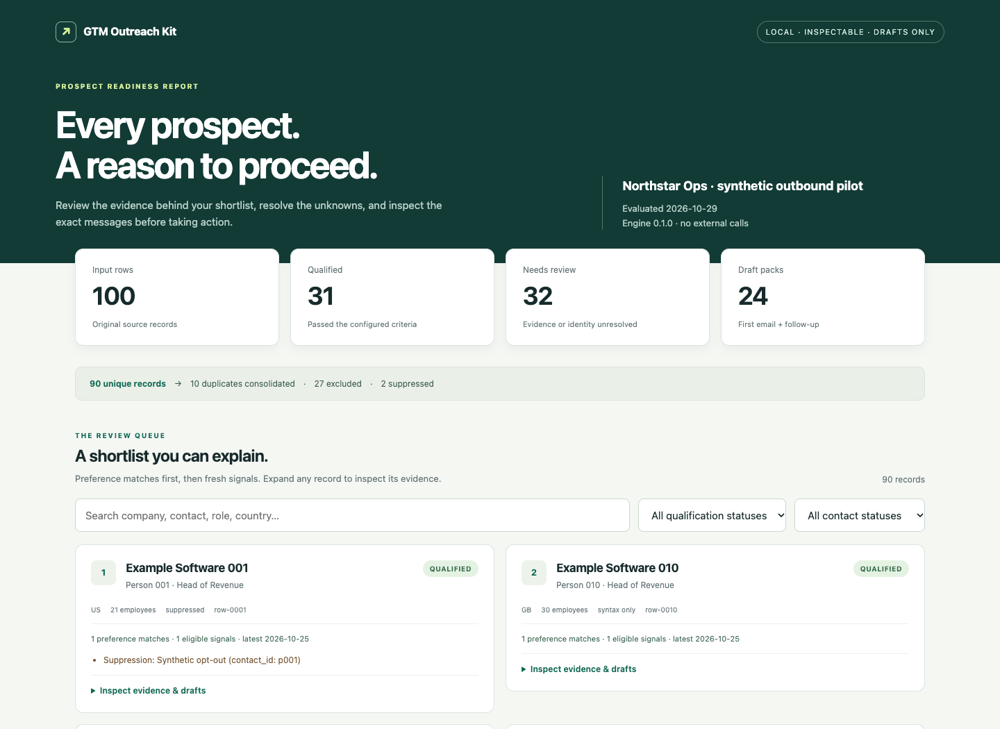

# GTM Outreach Kit

**Turn a prospect export into an outreach pack you can inspect.**

Original software and agent skills by **Aditya Chouhan**. Local Python CLI · six focused skills · zero runtime dependencies · no API keys.



[Open or download the complete synthetic report](docs/demo-report.html).

GTM tools often tell you who to contact without making the underlying decisions easy to audit. This kit makes those decisions explicit: which rows were merged, which criteria passed, which facts are missing, why a prospect ranks higher, and why a draft was withheld.

```text
Prospect CSV + business brief + optional signals and suppressions
                         ↓
Normalize → resolve duplicates → evaluate evidence → qualify → rank
                         ↓
           Draft packs + CSV exports + HTML review report
```

## Run it in two minutes

Python 3.11 or newer; Git is only needed to clone. From this repository:

```bash
python3 -m venv .venv
source .venv/bin/activate
python -m pip install .
gtmkit demo --out demo-output
```

Open `demo-output/results/report.html` in your browser. The workflow itself runs offline. Installation may download build tools; no model, provider account, or API key is used by the workflow.

The committed demo is **100 synthetic source rows**, including 10 duplicates. Its fixed evaluation date is October 29, 2026. Names, companies, signals, and suppression entries are fictional. The demo produces 90 unique records: 31 qualified, 32 needing review, 27 excluded, and 24 draft packs. These numbers demonstrate rule execution; they are not campaign results.

## Use your own data

```bash
gtmkit init --out workspace
# Replace the synthetic CSVs and edit workspace/brief.json.
gtmkit validate --input workspace/prospects.csv --brief workspace/brief.json
gtmkit prepare --input workspace/prospects.csv --brief workspace/brief.json \
  --signals workspace/signals.csv --suppressions workspace/suppressions.csv \
  --as-of 2026-10-29 --out results
gtmkit report --run results/run.json --out another-report.html
```

Every output destination must be new. A run never overwrites an existing output directory. `validate` checks structure and row syntax; `prepare` evaluates evidence, qualification, and eligibility. Omit `--signals` or `--suppressions` if unavailable; the report discloses the missing coverage. Use a suitable evaluation date for your own data.

| Output | What you can inspect |
| --- | --- |
| `run.json` | Original rows, normalized fields, conflicts, per-rule evidence, signals, rankings, blockers, configuration, and input hashes |
| `qualified.csv`, `review.csv`, `excluded.csv` | Portable prospect lists with disposition and contact status |
| `drafts.json` | First-email and follow-up drafts with supplied claim references |
| `report.html` | Searchable, filterable report with evidence and exact draft previews |

See [input contract](docs/input-contract.md), [architecture](docs/architecture.md), and [engineering case study](docs/case-study.md).

## Decisions with receipts

- **Evidence before fit:** each criterion names its source rows and supplied observation dates. Missing, stale, or conflicting required evidence goes to review.
- **Explicit exclusions:** supported exclusions override positive criteria. Unknown exclusion evidence also needs review.
- **Identity before merging:** contacts join by normalized email or explicit contact ID. Different people at one company remain separate. Conflicting merged values remain visible.
- **Fit and contact eligibility stay distinct:** suppressions block drafts. Missing or malformed emails cannot receive drafts. Valid syntax never claims a mailbox is verified.
- **Rankings explain themselves:** configured preferences come first, then relevant fresh signals, then latest signal date, then stable source-row ID. This is an ordering rule, not a conversion prediction.
- **Grounded draft rendering:** templates use supplied prospect fields and offer details. No invented case study, research, or performance proof. Rendering requires no LLM.
- **Reproducible runs:** fixed inputs, configuration, engine version, and evaluation date produce the same substantive output. No hidden clock, telemetry, or external assets.

## Agent skills

Six independently written skills help an existing assistant operate the toolkit:

| Skill | Job |
| --- | --- |
| [gtm-brief](skills/gtm-brief/SKILL.md) | Turn supplied context into an explicit qualification brief |
| [gtm-data-inspect](skills/gtm-data-inspect/SKILL.md) | Inspect mappings, invalid values, duplicate identities, and source coverage |
| [gtm-qualify](skills/gtm-qualify/SKILL.md) | Configure criteria and explain engine results |
| [gtm-prioritize](skills/gtm-prioritize/SKILL.md) | Review preference ordering and dated signals |
| [gtm-draft](skills/gtm-draft/SKILL.md) | Prepare drafts using supplied claims and review rendered wording |
| [gtm-review](skills/gtm-review/SKILL.md) | Inspect the complete pack and unresolved decisions |

Each folder is self-contained and uses the `SKILL.md` format with local supporting references. Copy the selected folder into your agent's documented skill directory, retaining its references. The CLI must be installed in that agent's terminal environment. UI metadata is provided in `agents/openai.yaml`; installation and model routing depend on the host. No automatic discovery across every agent is claimed.

The assistant may improve wording in conversation; the CLI does not call a model. Skill instructions cannot force a model to obey them. [Behavioral scenarios](docs/skill-scenarios.md) distinguish executable guarantees from assistant review expectations.

## Development and checks

```bash
python -m pip install -e '.[dev]'
python -m pytest -q
python scripts/check_skills.py
python scripts/check_examples.py
python -m build
```

CI runs the tests on Python 3.11–3.13, validates example documents against the published schemas, checks skill references, and installs the built wheel in a clean environment before running the documented commands. Local verification receipts are in [evidence](evidence/verification.json); a configured workflow is not a claim that remote CI has run.

## Boundaries

V1 consumes local CSV/JSON data. It does not discover companies, enrich contacts, verify mailboxes, send messages, schedule campaigns, publish content, or mutate a CRM. It does not independently verify source URLs or claims supplied in the brief. HTML includes local JavaScript for filters and no remote assets. Exported CSV formula-looking cells are prefixed with an apostrophe; JSON retains original values. Output artifacts can contain personal data supplied by the operator: keep real runs out of public commits.

## Inspiration and authorship

The public [OXYGEN GTM skills repository](https://github.com/OXYGEN-CRO/gtm-skills) prompted this project's focus on making agent-guided GTM work inspectable. GTM Outreach Kit is an independent implementation with original code, skill instructions, fixtures, templates, and documentation. OXYGEN's hosted product was not reproduced or benchmarked. This project is unaffiliated with OXYGEN.

Copyright © 2026 Aditya Chouhan. [MIT License](LICENSE).
