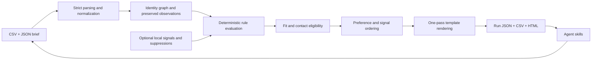

# Architecture

## Responsibilities

- `engine.py` owns parsing, configuration validation, normalization, duplicate identity resolution, dated evidence evaluation, suppression, ranking, and template rendering.
- `report.py` exports a saved run into portable artifacts. HTML escapes imported data; the browser changes presentation only. Original values remain inspectable. Output is staged and the destination is reserved exclusively before rename.
- `cli.py` wires the public commands and handles input/filesystem errors. No command sends messages or starts a provider job.
- `assets/` contains the report shell and the original synthetic fixture. These assets ship inside the wheel, so the demo runs outside the source checkout.
- `skills/` provides six self-contained instruction folders. Agents help formulate the brief and interpret outputs; all mechanical decisions come from the engine.

The runtime uses only the Python standard library. Schema validation and test/build tools are development dependencies. There is no HTTP client, telemetry, model SDK, daemon, secret store, account system, or remote database.

## Data flow and identity

The original CSV is immutable input. Each record has a stable row ID for that exact file order. Normalized observations retain raw rows and supplied source metadata. Contacts join by exact normalized email or explicit contact ID using connected components; a bridge can reveal conflicting identities rather than silently selecting one. Conflicting values block automatic qualification.

Each rule evaluates a value only when its source observation has a usable date and reference. Preferences never affect qualification. Signal relevance is independent of account fit; a disqualified record can have signals without receiving a rank or draft. Suppression applies to all known aliases and stays distinct from the fit label.

## Reproduction and extension

A run records SHA-256 hashes of input bytes, the complete effective brief, the evaluation date, and the engine version. Identical inputs reproduce identical results; paths and wall-clock time are excluded. This is traceability, not cryptographic attestation of source truth.

Future integrations should translate external exports into these public contracts. V1 deliberately has no adapter interface or placeholder connectors. Any future live action must have its own explicit contract and tests; a JSON draft is never a delivery receipt.

## Optional browser verification

`scripts/check_report.cjs` checks the committed synthetic report and refreshes its screenshots. It requires an independently installed Playwright package and Chromium browser. Run `node scripts/check_report.cjs docs/demo-report.html` in that environment. Set `GTMKIT_BROWSER_CHANNEL=chrome` to use a locally installed Chrome binary in an isolated headless session. Browser tooling is not part of the Python runtime or the quickstart.
